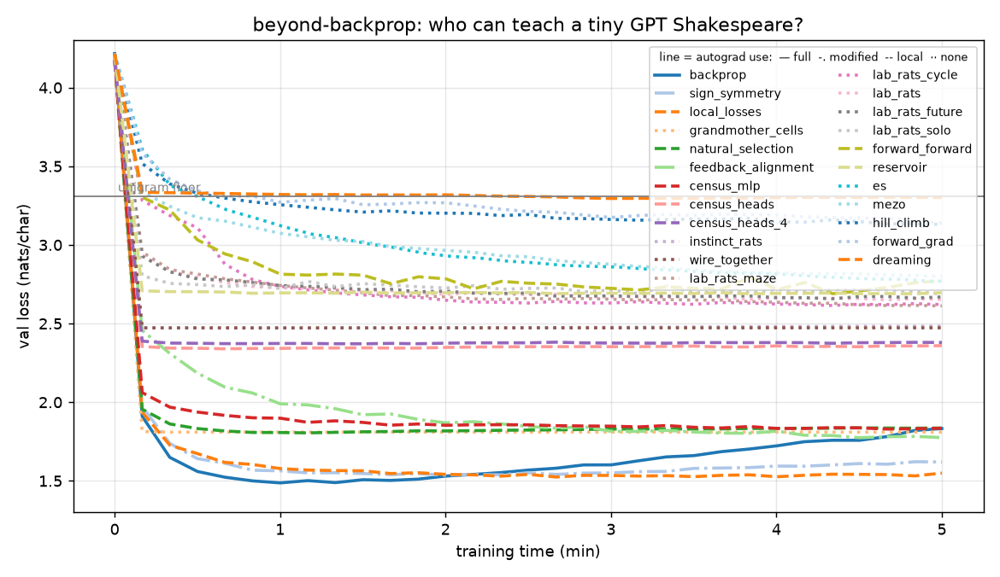

# beyond-backprop 🧠⚡

**A playground for learning rules that aren't backprop, tested on a tiny GPT.**

Backprop works absurdly well, and it's also kind of weird: a global error signal, a
perfectly symmetric backward pass, every activation stored until the update. Brains
don't seem to do any of that. So what else can train a language model?

This repo is a small, honest arena for finding out. Every idea, sane or unhinged,
trains the **same 0.8M-param character-level GPT** on **TinyShakespeare** for the
**same wall-clock budget**, and lands on one leaderboard. It runs on a laptop
(Apple-silicon GPU, CUDA, or CPU) in minutes.

Most of these will lose to backprop. That's the fun part. The interesting question
is *by how much*, and *why*.

## Leaderboard

<!-- LEADERBOARD:START -->
| # | rule | autograd | test loss ↓ | vs backprop | beats random reservoir? | best ckpt at | steps | fwd passes | tuned |
|---|------|----------|-----------:|------------:|:--:|------:|------:|-----------:|-------|
| 1 | `backprop` | ✅ full | 1.629 | +0.000 | yes | 1.0 min | 23,871 | 23,871 | lr=0.00067 |
| 2 | `sign_symmetry` | 🪞 modified | 1.675 | +0.047 | yes | 2.0 min | 20,864 | 20,864 | lr=0.001 |
| 3 | `local_losses` | 🧱 local | 1.743 | +0.114 | yes | 2.7 min | 18,457 | 18,457 | lr=0.002 |
| 4 | `grandmother_cells` | 🚫 none | 1.899 | +0.270 | yes | 0.3 min | 68,804 | 68,804 | kappa=12 |
| 5 | `natural_selection` | 🧱 local | 1.905 | +0.277 | yes | 1.2 min | 53,307 | 53,307 | lr=0.001 |
| 6 | `feedback_alignment` | 🪞 modified | 1.911 | +0.282 | yes | 4.5 min | 21,233 | 21,233 | lr=0.001 |
| 7 | `census_mlp` | 🧱 local | 1.954 | +0.326 | yes | 4.7 min | 31,602 | 31,602 | lr=0.001 |
| 8 | `census_heads` | 🧱 local | 2.369 | +0.740 | yes | 0.7 min | 31,549 | 31,549 | lr=0.001 |
| 9 | `census_heads_4` | 🧱 local | 2.408 | +0.780 | yes | 1.5 min | 34,110 | 34,110 | lr=0.001 |
| 10 | `instinct_rats` | 🚫 none | 2.498 | +0.869 | yes | 0.8 min | 16,849 | 33,598 | lr=3.7e-06 |
| 11 | `wire_together` | 🚫 none | 2.500 | +0.871 | yes | 0.8 min | 65,165 | 65,165 | smoothing=2.7 |
| 12 | `lab_rats_maze` | 🚫 none | 2.610 | +0.981 | yes | 5.0 min | 16,662 | 33,324 | lr=0.00033 |
| 13 | `lab_rats_cycle` | 🚫 none | 2.611 | +0.982 | yes | 4.3 min | 28,804 | 57,608 | lr=0.001 |
| 14 | `lab_rats` | 🚫 none | 2.650 | +1.021 | yes | 4.7 min | 16,558 | 33,116 | lr=0.00033 |
| 15 | `lab_rats_future` | 🚫 none | 2.660 | +1.032 | yes | 4.3 min | 16,840 | 33,680 | lr=0.00033 |
| 16 | `lab_rats_solo` | 🚫 none | 2.692 | +1.064 | yes | 5.0 min | 5,737 | 57,370 | lr=0.003 |
| 17 | `forward_forward` | 🧱 local | 2.698 | +1.069 | yes | 4.3 min | 10,107 | 20,214 | lr=0.009 |
| 18 | `reservoir` | 🧱 local | 2.716 | +1.088 | — | 3.8 min | 52,867 | 52,867 | lr=0.003 |
| 19 | `es` | 🚫 none | 2.788 | +1.160 | no | 5.0 min | 895 | 57,280 | lr=0.003 |
| 20 | `mezo` | 🚫 none | 2.818 | +1.190 | no | 5.0 min | 25,747 | 51,494 | lr=0.0009 |
| 21 | `hill_climb` | 🚫 none | 3.153 | +1.524 | no | 5.0 min | 24,757 | 49,514 | sigma=0.01 |
| 22 | `forward_grad` | 🚫 none | 3.167 | +1.539 | no | 5.0 min | 9,280 | 9,280 | lr=0.0018 |
| 23 | `dreaming` | 🧱 local | 3.331 | +1.702 | no | 3.0 min | 21,607 | 43,214 | lr=0.0003 |
| | *unigram (letter frequencies only)* | | 3.309 | | | | | | |
| | *untrained / uniform guess* | | 4.216 | | | | | | |

<sub>0.83M-param char GPT (4 layers, d=128, ctx 128), batch 32, TinyShakespeare, 5 min of training time per rule on `mps`, loss in nats/char. Early stopping: each rule's best checkpoint by val loss is scored on a held-out test split. Each rule's `tuned` knob got a 3-point sweep first.</sub>



<details><summary>What each rule's model writes after its run (prompt <code>ROMEO:</code>)</summary>

**backprop** (test 1.629)

```
ROMEO:
Thou must have sell me of your holy daughter,
Because to give thee that the house is son?
To him stands, your way, and come already, no; my
father we will not carriied to the head and her fruit,
I hold yet for his files foes, the maring of mercy,
Their still to their seating of the queen.

ME
```

**sign_symmetry** (test 1.675)

```
ROMEO:
Thou mayst have not made thee hanging.
I toe there courty he now here here would
The sense of these attors or way were comes;
And true nearnest of well stone and winders,
By the contrarch from the forth to fair it?

MERCUTIO:
Has their come?

POLIXENES:
They speed and grown be them.

EDWARD:

```

**local_losses** (test 1.743)

```
ROMEO:
Thou must know'st the decay?
That ways I to thee, I was you for me
To have think the sensuader by that of the way,
For commony thee, nor my father we would for me
I seek that the Lancaster,
I shall be my pray thee--
Whom on not say that of me for my in
This medicitizens. Boy! Fare not to the 
```

**grandmother_cells** (test 1.899)

```
ROMEO:
That more it when?

WARWICKINGHAMILLA:
I to the Mespeak you for bear? hath thin to have many him; that of to his perman.

COMILLA:
A not my father we why marraight is hither.

DUCHI king.

FRIAR LAUREY:
To fair in mily mood not say, if to queen I much let's me thou,
As to bed, your for the st
```

**natural_selection** (test 1.905)

```
ROMEO:
Thy, my sever:
Hell me Hear ears!

LADUMBAle feere courself that here hath thin to blooke of him; that of to yieldeen herself
And trunkn my father well you for mindious the duke contring.

FRRENCESTER:
There it is milk moot, hearty, if the light of with the me thou,
As to bed, then to make ha
```

**feedback_alignment** (test 1.911)

```
ROMEO:
Tutry his kiss selves ouch of hang,
Nor gelse than of to giventreather strught she ever igns,
For that of to a to be ancesenay thour nee mothereing penty one.

So king?

LENRLEY:
I not sweear strue:
I knew farew dam, you of not say, if come defence,
And the me here, my pown, to the at to the 
```

**census_mlp** (test 1.954)

```
ROMEO:
Thorerhood her selfeelook iner,
And id I to the My ory with that here hath thin this seembleeath
steath, your wake a man:
What thee, nd the fitsed we with to acar I meeto the he connot sweet the man and ented this filk.
Woen hear you at of me forond in this me thou,
As to bed, young on the st
```

**census_heads** (test 2.369)

```
ROMEO:
Thy formed hawiselled?
HERDWerakn woud wotlste gancoure you fot meare hath hou s chelleseane himest atho y or wak we ancesend winder non my f thed we w y tof aim whise tot anches I t s mf the s f. h anofe made fies ily moon norssay,
II coue d fllome inou ind the thang.

Kingbe y torest cor st
```

**census_heads_4** (test 2.408)

```
ROMEO:
Th rememed har sellered, andearan youd wotlst, grecofured hit therere hath hou s orelisse ton icost.


WINTor wake paricos iay thour nond fam thod we w y tof aim whise tot anche co t s upre
I che. V:
INooora pif andily moon norssay, int oue d fllome inou ing t t thing.

Kin,
S y ton on ghe th
```

**instinct_rats** (test 2.498)

```
ROMEO:
th rememe ke whenllered ca meaman youd INAlste grecoure y hiththerere hath thin berelis s tongilost atho y we w ke e ancot idarthotr nd; my f thed we w y t f aim whiserethind te co n s u.


I s h. fo INVe thaithie mily mpofond ssay tint oueld fleome inou ind t he the s t inobe y tonoon g t st
```

**wire_together** (test 2.500)

```
ROMEO:
th remofe ke whenllerede a meaman youd INAlste grecofurey hiththerere hath thin berelleseanongilost atho y we w ke e ancot idarthorr nd; my f thed we w y t f aim whiserethind te co n s u.
Whe s h. fo INVI thapllie mely mpofond ssay tint oueld fleome inou ind t he the s t inobe y tonesthast st
```

**lab_rats_maze** (test 2.610)

```
ROMEO:
Tu remhis ke whselterlouca meraan youd Iwelste grelo y wy he ntherere heth thin berelousog serid st atho y we w ke e ancot yare fotr nd d han ttoo we w yt to ar'f Iiserethe,
Whe c b'
s szen
I s h. fo Inotorf pifid wily moonond ssareeint ouqld fleome inle ind t s thanc.
I inobo y tonesthasof t
```

**lab_rats_cycle** (test 2.611)

```
ROMEO:
Ty re his ke whenlte louca meaman youd INAlste greco atoy h thaverere he?

Sou s thelis s ton ilose atho y we w k we alcos idarinder nd; mit thyoo we w yt to atif Iiserdotond te c an s shed
I s h.S:
HIUVepranithid mily mooe nd ssay tint ou ld fleome inle ind t s thin s toinsbo y ton tt g t st
```

**lab_rats** (test 2.650)

```
ROMEO:
Thore hisd hes selte loHou meaman youd Ixtlst t Meco uroy he nt beere heth thin berelis sg serilose atho y we we per ancos iare fofr nd- mit thyoo we w y t f acin Iiserethind tesco n s uwed
Iur h. f antolorf pif and ly moof nhessay ed t ou ld fleo thinle ind t he the s t in,
S y ton theg t st
```

**lab_rats_future** (test 2.660)

```
ROMEO:
Tu remr t ke whselterlouca merador, id Ixtlste ganco urey he ntherere heth thin berelis sgoferilose atho y or it ber ancos idar forr nen met theno we wostour arin Iiserethe,
O t c an s uwenrur nr.Sevantolorf pirir-milr m,
ennthasareeint ou ld fleome inle ind t s thinms totoube y tonesthasof t
```

**lab_rats_solo** (test 2.692)

```
ROMEO:
tlsremhes ke w selterlouca meroan yoNanthelste gancofuroy h f therere hath thin merelllseg ser mosthathofy we w cher alcesendar;, tallend ham ttoo we w yt to acif Iimertoto,
ONAwc an s uwe


RSOCIS:
HImoe mf pllir mely mooennd seamfeimecomeld fllome inou ime t s thong.
Aminobo y ton the sof t
```

**forward_forward** (test 2.698)

```
ROMEO:
ty remhis kess selteelouce neaman yodd Ihelsteterelo urey h t t beere heth tot s orel s s de hil
Wed tso y or i d we alcos idarthoer nd- mhaf ttoor s wustonodrimf Iiserdott,
Whesc b ts uwed

RSOCur wanofeprf pirir-O:
HATooennhe sarfeint o q d fl o I inou ind t h t d m.
Hoinoro y toresthase st
```

**reservoir** (test 2.716)

```
ROMEO:
TENGLOhis kARGLs:
WIULoHER heamanUCaid INtlstherd houre y he ntheeare hath hou seerel s hanorre tsthathory we w akeraricothiay thofa nd- myt thyoo we wootour aim wIiouovoto d te c an s u.
B
Tu th.
So I fe EN ithi

Oilyompou noussay fiot ou ld fo o I igl bimy t u ou,
Bs toinout y tonouthasof t
```

**es** (test 2.788)

```
ROMEO:
cu remhis khes selteeloH t meaman yodd Igels e gMeco ue y he nte here he?

Sot s chel s me onre t t atho y we w apee ancos id
J


:
And d han thoo we wost te acif Iinerethond te c an s uz


IRSnr.SSo I

T3rf porir mily moon n t say fins od ld fe ome inl zMThee t thon s
I:


FS y tonoon gor ha
```

**mezo** (test 2.818)

```
ROMEO:
EW remhit hhes seltemlouca meamay yayd Iotlste gMeloyae y he ntheeere heth thin be elis ig sere t thathory we w ky e ancos yay thoer nd t faf theo we w y t f ar'f Iioerdot ad t wc an s uw the s h. fo Iofend, pur and lr mooennd ssay tint od ld fl ome inl zind t s t sn s t inobt y ton t t sof t
```

**hill_climb** (test 3.153)

```
ROMEO:
ts re hOt khawhs:lte toHct me manlrodd Ig
ls e gMe o ue y h thty
here hath thoos thelod so the mose atso y wr w k we aRces iaretho:r ndn mot t tod we w yt donrim d iodovot , thes  an s uw t
ur nr.S w Inyepr, ithi

welyAmoonnn,rssay ed t odeld fl ome inle innleps t dnm.
t in,dS y tononEng t  t
```

**forward_grad** (test 3.167)

```
ROMEO:
t
 re h

d t wLselteeloH u neaheorrocd Ig
lst tgM ccfueoy n fnt bhhre h th thib me el sBeg sehe t t athof ler w k w

ahees uare fotr nene th theoor s w yt te ai'f Iioeotot ad t s  an s uz f

e n..Se aIofeorf pe ne mily mooe n t say eiI codele fleomeeinor imkee s t dn se.oinobe y th tot g r s 
```

**dreaming** (test 3.331)

```
ROMEO:
ts remhmsd hewTsnlteWloHca  eahao roid IgelstetgMeco uewygh  nt bherM hstn toi s
eiel sBeg eehi tst atso yler i kpwe ahcesruaaet,oer nen mha  tsooe e n 
t ne ai'  IioeoEotg, t e c an s uY t
u  nr.S  a
ooeorf pihi

Oier mWoe nhr sayfeiIsco eldhel o tei le i kee s o ,n s
t in
bS yteoheoEngsr  t
```

</details>
<!-- LEADERBOARD:END -->

**What the first run says** (one seed, 5 minutes, so hold it loosely)
- **Backprop still wins**, and it gets there fast: it peaks after 1 minute, then starts memorising.
- **Sign symmetry is within 0.05 nats.** A backward pass that only knows the *signs* of
  the weights, not their size, is nearly as good as the real gradient here.
- **Local per-block losses come third (+0.11)** with no gradient ever crossing a block
  boundary, and they overfit far more slowly than backprop.
- **Feedback alignment (+0.28) is still improving at minute 5.** Random feedback works,
  just slower, because the forward weights first have to "align" with it.
- **Forward-Forward only barely beats a frozen random network** (2.698 vs 2.716): its blocks
  learn something, but almost none of it helps predict the next character.
- **The classic no-backward-pass rules all lose to the frozen random network.** ES, MeZO,
  forward-gradient and hill-climbing jiggle *weights*, and one loss number per forward pass
  is hopeless signal for 830k of them.
- **🐀 `lab_rats` is the first no-backward-pass rule to beat the floor** (2.649 mean over 3 seeds vs 2.716,
  and ahead of Forward-Forward). It jiggles *neurons* instead, independently at every one of
  the 4,096 tokens in a batch, so two forward passes run 4,096 tiny experiments at once.
  Its gradient estimate lines up with the true gradient at cosine 0.01–0.16 per layer,
  vs ~0.0003 for a MeZO-style random direction. Still +1.0 nats behind backprop, and still
  improving at minute 5: plenty of room in this bracket. Go win it.
- **📊 …and then plain counting beat all of them.** `wire_together` does no optimisation at all:
  it tallies which character follows which and writes the counts into the weights in closed
  form, turning the transformer into an exact bigram model. **2.500, in under a minute**,
  ahead of every gradient-free *learner* here, Forward-Forward, and the random reservoir.
  **This is the real bar for the 🚫 bracket:** a rule that can't beat counting letter
  pairs hasn't learned anything a census couldn't. To beat it, a rule has to make use of
  *earlier* characters, which means training attention.
- **🔎 A census can teach attention with a layer-local rule.** `census_heads` scores **2.369**
  (3 seeds) vs 2.488 for the same network with frozen heads and 2.500 for counting. It never
  calls autograd, but its Q/K update is the chain rule hand-written inside one layer, so it is
  🧱 local. It was first published here as 🚫 none; that was wrong, and counting
  is still the bar for the 🚫 bracket.
- **👵 The bar moved, by counting more.** `grandmother_cells` (🚫 none) scores **1.900** over 3
  seeds by giving each MLP neuron one string to remember. It is n-gram counting compiled into
  the weights, with hand-wired attention, so it is a better *counter*, not a better learner.
- **🧬 Neurons that die and breed work; being choosy about where they are born does not obviously
  help.** `natural_selection` (🧱 local) scores **1.896** over 3 seeds. Killing the *useless* cells
  matters a lot (random deaths: 2.068). Births at surprising places: 1.896 vs 1.902 at random
  places, which is inside the noise.
- **A plain 5-gram table still beats most of this board.** Backoff tables score 2.504 / 2.113 /
  1.865 / 1.782 on test for 2- to 5-grams (`scripts/ngram_reference.py`, smoothing not tuned).
  Only backprop, sign symmetry and local losses beat the 5-gram.

### 🐀 Lab rats lab notebook: three attempted fixes

The diagnosis: lab_rats' later layers get decent signal, but **block 0 gets ~none**
(cosine ≈ 0 with its true gradient), and attention `qkv` gets ~none in every block.
Three fixes, each its own rule, each run on 3 seeds (test loss, lower is better):

| rule | the fix | seed 0 | seed 1 | seed 2 | mean | verdict |
|---|---|---:|---:|---:|---:|---|
| `lab_rats` | (original) | 2.650 | 2.651 | 2.647 | 2.649 | |
| `lab_rats_maze` | block 0 gets its own little readout and is credited mostly by that nearby loss (+30% global) | 2.610 | 2.626 | 2.623 | **2.620** | ✅ wins all 3 seeds |
| `lab_rats_cycle` | jolt one block per step, round-robin: less crosstalk, same cost | 2.611 | 2.662 | 2.610 | 2.628 | 🤷 wins 2 of 3, noisy |
| `lab_rats_future` | attention jolts credited with the loss change at all *later* tokens (returns-to-go, γ=0.9) | 2.660 | 2.652 | 2.644 | 2.652 | ❌ no gain |
| `lab_rats_solo` | every block jolted in its own pair of passes (5× cost) | 2.692 | | | | ❌ clean signal, too few steps |

What the gradient probes showed along the way (cosine of the estimate with the true gradient):
- **Jolting one block at a time** cleans up the *later* layers a lot (readout −0.01 → +0.23,
  block 3 → +0.14), but block 0 barely moves. Running all 5 blocks separately costs 5× the
  passes and loses; taking turns keeps the cost and is a coin flip.
- **Cross-token credit** does partly un-blind attention (block-2 `qkv` −0.03 → +0.06) but
  pours noise onto layers that only affect their own token (readout 0.67 → 0.14 at γ=1).
  Restricted to attention, it nets out to nothing.
- **Local readout for block 0** wins, but *not* the way intended: block 0's attention and MLP
  weights stay at cosine ≈ 0.01 even against a loss one step away. Only the embedding clearly
  improves (0.06 → 0.17). Probably the gain is a better-trained embedding. It also starts
  slower (worse at minute 1) because the readout has to learn first, then overtakes by minute 5.
- **The real wall:** every token's loss change is one number shared by thousands of jolted
  neurons, and block 0's MLP and attention have a tiny share of it. Moving the loss closer
  doesn't change that ratio. Ideas welcome: per-layer noise scaling, low-rank jolts, or
  learning a local *predictor* of the loss change (synthetic-gradient style).

### 🧪 The extreme batch: counting, instincts, and dreams

| rule | the idea | seed 0 | seed 1 | seed 2 | verdict |
|---|---|---:|---:|---:|---|
| `wire_together` | "Fire together, wire together", literally: count letter pairs, compile them into the weights. Zero optimisation. | 2.500 | | | 📊 the bar for 🚫 rules; deterministic, so one run |
| `instinct_rats` | Born wired as a bigram, then `lab_rats_maze` keeps learning on top. Nature, then nurture. | 2.498 | 2.498 | 2.499 | 🤷 nurture adds nothing |
| `dreaming` | Awake: strengthen what fires on real text. Asleep: weaken what fires on the model's own dreamt text. | 3.331 | 3.322 | 3.323 | 💀 dreams erase everything |

- **Counting is exact.** The compiled transformer's loss matches a lookup-table bigram to 4 decimals (2.4552 both ways).
- **Instincts are fragile, then frozen.** The first version had 1-sized one-hots, and lab rats
  wrecked the wiring within seconds even at lr=1e-6: `ln_f` divides by a tiny std, so any
  trickle the blocks leaked into the stream got amplified ~11×. Bigger one-hots fix that, since
  LayerNorm erases scale, but then the blocks barely move the output, and the lr sweep
  walks the learning rate down to ~0. Either way lab rats can't get past the bigram:
  doing that needs attention, the one thing it can't train.
- **"We dream in order to forget"** (Crick & Mitchison 1983), confirmed. The dreaming readout
  alone gets an honest delta-rule signal and reaches 2.73 (≈ the random reservoir). Switch on
  the wake/sleep Hebbian in the hidden layers and it collapses to 3.32, worse than letter
  frequencies, within the first 10 seconds, and never recovers. Contrasting real text
  against the model's own early dreams (≈ random letters) apparently teaches the features
  "is this real text?" and nothing about *which* character comes next.
  (Relabelled 🚫 → 🧱: its readout is the delta rule, held to the same standard as `reservoir`.)

### 🔎 Census heads: training attention with a layer-local rule

`census_heads` trains *only* attention (plus the readout), with no error signal crossing a layer:

1. **The stream is wired, not learned:** `[one-hot current char | sinusoidal position | what the heads fetched]`.
   Each head's values are a fixed random code of the character it lands on; every other block output is zeroed.
2. **E-step:** a running census of (current char, char *d* back, next char) gives, for each query,
   the posterior over which earlier position caused the next char:
   `posterior(s) ∝ attention(s) · P(y | x_t, x_s, d) / P(y | x_t)`.
3. **M-step:** delta rule on the head's own scores, `dS = attention − posterior`, turned into Q/K
   updates through the head's bilinear form. A test pins this update to autograd of the
   equivalent per-head loss, so it is exactly a *local* attention gradient (hence 🧱, not 🚫).
4. **Readout:** the delta rule (exact last-layer gradient, computed by hand).

| variant (`census_heads`, 2 heads, 5 min) | seed 0 | seed 1 | seed 2 | mean |
|---|---:|---:|---:|---:|
| heads **frozen** at random init (never trained) | 2.490 | 2.486 | | 2.488 |
| heads **trained by census EM** | 2.369 | 2.368 | 2.371 | **2.369** |
| heads **hand-wired** to look exactly 1 and 2 back (a reference, not a proven bound) | 2.288 | 2.290 | | 2.289 |
| `census_heads_4`: 4 census heads, half the stream dims each | 2.408 | 2.400 | 2.400 | 2.403 |

**Corrections to the first published version of this section (commit 0e0ded8):**
- It was labelled 🚫 none. It is 🧱 local: the guard only catches autograd, and this update is the
  chain rule hand-written inside one attention layer.
- It said the self-prior was essential. It is not: over 3 seeds and 5 minutes each, a uniform prior
  scores 2.368 / 2.367 / 2.366, the self-prior 2.369 / 2.368 / 2.371. Sharper-looking attention did
  not mean a better model.
- It said 29% of attention fell beyond the census horizon. That number counted everything more
  than 5 back; the horizon is 8.
- It explained the gap to the hand-wired heads as "blending", the 4-head result as cramped codes,
  and the early plateau as a capacity limit. Those are untested guesses.
- Hand-wired heads are a reference, not a proven upper bound.
- Value codes are fixed across seeds, so the spread between seeds understates the real variance.

### 🧠 Census MLP: census heads plus a hidden layer taught by random feedback

`census_heads` can only *add up* evidence from the current and fetched characters. `census_mlp` adds
one MLP trained by direct feedback alignment (the output error, broadcast through fixed random
matrices). Label: 🧱 local, and that is a judgement call. Nothing is backpropagated from block to
block, but a global error is broadcast, and it goes through `ln_f`'s hand-written Jacobian.

| variant (5 min) | seed 0 | seed 1 | seed 2 | mean |
|---|---:|---:|---:|---:|
| **census_mlp** (2 census heads + 1 DFA MLP) | 1.954 | 1.965 | 1.964 | **1.961** |
| heads frozen at random init | 2.440 | 2.439 | | 2.440 |
| heads hand-wired to 1 and 2 back | 1.871 | | | |
| MLP frozen (heads and readout only) | 2.363 | | | |
| uniform prior instead of self-prior | 2.071 | | | |
| no `ln_f` correction on the feedback | 2.230 | | | |
| exact feedback instead of random (*diagnostic*, hand-written backprop) | 1.937 | | | |
| 4 heads instead of 2 | 1.976 | | | |

- The MLP is what takes `census_heads` from 2.369 to about 1.96, and *where the heads look* matters
  as much as the MLP. Both parts are needed.
- Replacing random feedback with the exact error gains only 0.017 on test (one seed), though val
  improves more, 1.837 to 1.775. So how much random feedback costs is unsettled.
- The uniform prior hurts here (2.071 vs 1.954, one seed) though it makes no difference to
  `census_heads`. Do not lean on one seed.
- 2-minute runs: 1 / 2 / 4 stacked MLPs score 1.966 / 1.984 / 2.024. Deeper did not help.
- It loses to `local_losses` (1.743). It also trails `natural_selection` (1.896), but that rule is
  given hand-wired copy heads; with its own heads hand-wired, `census_mlp` gets 1.871 (one seed).

### 👵 Grandmother cells: one neuron per memory

Head h is **hand-wired** to copy the character h+1 back. Each MLP neuron is an AND-gate for one
recent string ("the ", "ROME"). Counting decides which strings get one of 2,048 neurons (most
log-likelihood gained over the one-char-shorter string), and each neuron adds
`log P(next | string) − log P(next | shorter string)`, so the cells along a suffix chain telescope.
No gradient, no error signal. It counts for 2,000 batches, then stops learning.

| | test |
|---|---:|
| **grandmother_cells** (seeds 0 / 1 / 2) | 1.899 / 1.899 / 1.903 |
| bigram table (`wire_together` is this) | 2.504 |
| trigram table | 2.113 |
| 4-gram table (11,228 contexts) | 1.865 |
| 5-gram table (48,539 contexts) | 1.782 |

- It sits between the 3- and 4-gram tables because it has 2,048 neurons, not 11,228 contexts. This
  is compression of a table, and a table with no size limit does better.
- `kappa=12` was picked by the same 1-minute sweep every rule gets.
- The smoothing constant assumes a corpus of about 1M characters.
- Cells misfire on the first 4 positions of a window, where the copied characters do not exist yet.
  Known, not fixed, small effect on the average.
- Seed changes the batches counted, not the wiring, so the spread understates the real variance.

### 🧬 Natural selection: neurons that die and breed

Starts with 65 single-character neurons. Output weights follow the delta rule. Every 50 steps the
5% of cells that move the logits least are killed, and mutants of living cells (one more character
constraint, or one fewer) take their places. Which strings the hidden neurons detect is never set
by an error gradient. Label 🧱 local: the delta rule is the one-layer readout gradient.

| variant | seed 0 | seed 1 | seed 2 | mean |
|---|---:|---:|---:|---:|
| **natural_selection** (surprise births, useless cells die) | 1.905 | 1.903 | 1.879 | **1.896** |
| births at random places | 1.910 | 1.901 | 1.895 | 1.902 |
| **deaths at random** | 2.072 | 2.063 | 2.068 | 2.068 |
| no evolution (2 min; 65 fixed cells, so about a bigram) | 2.499 | | | |
| start from a full `grandmother_cells` network | 1.931 | | | |

- **Selection is doing real work:** random deaths cost 0.17. Evolution takes it from 2.50 to 1.90.
- **The "born where it is surprised" idea is not established.** The gap to random births (0.006) is
  inside the seed-to-seed spread (0.03), and the sign flips on seed 1.
- Starting from a counted network did not help: test 1.931 (val 1.799), one seed, vs test 1.905
  (val 1.804) from 65 single characters.
- `gen_every`, `cull` and the surprise switch were chosen on val in a small 1-minute seed-0 sweep;
  `lr` in the standard sweep. The ablations reuse those settings without their own sweep.
- Like `grandmother_cells` it uses hand-wired copy heads, and the plain 4-gram table (1.865) beats
  it. It reaches the same loss as counting by trial and error, not a better one.

**How to read it**
- **test loss**: cross-entropy on held-out Shakespeare, nats per character. Lower is better.
  4.17 = uniform guessing over 65 chars, ~3.3 = knows letter frequencies only, ~1.5 = writes pseudo-Shakespeare.
- **best ckpt at / early stopping**: TinyShakespeare is small. Backprop rips through ~90 epochs
  in 5 minutes and starts memorising the training text after about a minute. Scoring the
  *last* weights would reward rules for being bad at overfitting, so the data is split
  90/5/5 train/val/test: every rule keeps its best checkpoint by val loss, and that
  checkpoint is scored on a test split it has never seen. "best ckpt at" shows when each rule peaked.
- **autograd**: how much each rule leans on reverse-mode autodiff.
  🚫 `none` = no backward pass anywhere (**enforced**: the arena makes `.backward()` and `torch.autograd.grad` raise) ·
  🧱 `local` = backprop only *inside* a layer/block, never end to end ·
  🪞 `modified` = end-to-end backward pass, but not the true gradient ·
  ✅ `full` = backprop.
- **beats random reservoir?**: `reservoir` freezes the random network and trains only the
  final readout. If a rule can't beat that, its deep layers aren't really learning.
- **fwd passes**: total full-model forward passes spent. Wall-clock is the budget, but this
  shows how compute-hungry each idea is (ES burns 64 per step, backprop 1).
- **tuned**: each rule's one most important knob got the same quick sweep (×⅓, ×1, ×3,
  extended if the best was on the edge) before its final run. Nobody loses to a bad guess.

## The contenders

| rule | autograd | the idea | from |
|------|----------|----------|------|
| `backprop` | ✅ full | The baseline. AdamW. | Rumelhart, Hinton & Williams 1986 |
| `feedback_alignment` | 🪞 modified | The backward pass sends errors through **fixed random matrices** instead of Wᵀ. Somehow the forward weights learn to "align" with them. | Lillicrap et al. 2016 |
| `sign_symmetry` | 🪞 modified | Backward pass through `sign(W)`: the feedback knows the signs of the weights but not their size. | Liao, Leibo & Poggio 2016 |
| `local_losses` | 🧱 local | Every block gets its own tiny next-char readout and learns greedily. Gradients never cross a block boundary. | Belilovsky et al. 2019; Nøkland & Eidnes 2019 |
| `forward_forward` | 🧱 local | Hinton's FF for a causal LM: each block learns high "goodness" on real text, low on text with swapped chars. The readout is a probe on top. | Hinton 2022 |
| `reservoir` | 🧱 local | Random frozen transformer, only the readout trains. Sanity floor. | Jaeger 2001 |
| `forward_grad` | 🚫 none | One forward-mode JVP along a random direction v gives (∇L·v); use (∇L·v)v as the gradient. Unbiased, hugely noisy. | Baydin et al. 2022 |
| `mezo` | 🚫 none | SPSA: nudge all weights by ±εz, compare two losses, step along z. No autograd, no activation memory. | Spall 1992; Malladi et al. 2023 |
| `es` | 🚫 none | Evolution strategies: 64 noisy clones evaluated in parallel with `vmap`, ranked, weights drift toward the winners. | Salimans et al. 2017 |
| `lab_rats` 🐀 | 🚫 none | **Every token is an experiment.** Jolt every neuron with fresh noise at every token, run ±noise forward passes, and credit each token's loss change to that token's jolt. Each layer then updates Hebbian-style (jolt-credit ⊗ its own input). No backward pass, no weight transport, only a per-token "dopamine" loss signal. | node perturbation (Williams 1992; Fiete & Seung 2006) + per-token credit in a causal LM (the twist tried here) |
| `lab_rats_maze` 🐀 | 🚫 none | lab_rats + block 0 gets its own next-char readout ("local maze") and is credited mostly by that nearby loss. Best lab_rats so far. | + local readouts à la Nøkland & Eidnes 2019 |
| `lab_rats_cycle` / `_solo` / `_future` 🐀 | 🚫 none | The other attempted fixes: one block per step, every block separately, cross-token credit for attention. See the lab notebook above. | |
| `wire_together` 📊 | 🚫 none | No optimisation: count which char follows which, then compile the counts into the weights in closed form (one-hot embeddings, silenced blocks, pseudo-inverse readout). An exact bigram in a transformer costume. | Hebb 1949; Shannon 1948 |
| `instinct_rats` | 🚫 none | Born wired as that bigram, then `lab_rats_maze` keeps learning on top. | this repo |
| `dreaming` 💤 | 🧱 local | Wake/sleep Hebbian: strengthen what fires on real text, weaken what fires on the model's own dreams; readout learns real-vs-dreamt next char (the delta rule). | Hinton & Sejnowski 1983; Crick & Mitchison 1983; Hinton 2022 |
| `census_heads` / `_4` 🔎 | 🧱 local | **Attention taught by a census.** Running letter-triple counts say which earlier char best explains the next one (E-step); each head's scores move toward that posterior (M-step). Wired stream, fixed random value codes, delta-rule readout. Hand-written, layer-local gradients. | Dempster et al. 1977 (EM); Liu et al. 2016 (supervised attention) |
| `census_mlp` 🧠 | 🧱 local | `census_heads` plus one MLP trained by direct feedback alignment, so it can learn character conjunctions. | Nøkland 2016 |
| `grandmother_cells` 👵 | 🚫 none | One neuron per memory: each MLP cell fires for one recent string, chosen and wired by counting. Copy heads are hand-wired. | Lettvin's grandmother cell; Cleary & Witten 1984 (PPM); Willems et al. 1995 |
| `natural_selection` 🧬 | 🧱 local | Cells that do the least die, mutants of the living are born, output weights follow the delta rule. Hand-wired copy heads. | Edelman 1987; Fahlman & Lebiere 1990; Widrow & Hoff 1960 |
| `hill_climb` | 🚫 none | Jiggle every weight at random; keep it if the loss dropped. The dumbest possible learner, as a floor. | Rechenberg 1973 |

## Quickstart

```bash
git clone https://github.com/ozkilim/beyond-backprop && cd beyond-backprop
python -m venv .venv && source .venv/bin/activate
pip install -e ".[dev]"

python -m bbp.arena --list                          # what's in the arena
python -m bbp.arena --rule backprop --minutes 1     # train one rule, prints a Shakespeare sample
python -m bbp.arena --rule mezo --set lr=3e-4 eps=1e-3
python -m bbp.tournament                            # the full leaderboard (sweeps + 5-min finals, ~2h)
python -m bbp.leaderboard                           # rebuild the table + plot from results/
pytest                                              # every rule takes a few steps on a tiny CPU model
```

TinyShakespeare (1.1 MB) downloads itself on first run.

## Add your own crazy idea

One file, one class. Copy [`bbp/rules/_template.py`](bbp/rules/_template.py) to
`bbp/rules/your_idea.py`:

```python
from . import Rule, register

@register
class MyIdea(Rule):
    name = "my_idea"
    autograd = "none"      # be honest; "none" is enforced
    blurb = "Weights learn by vibes."
    defaults = dict(lr=1e-3)

    @torch.no_grad()
    def step(self, x, y):              # x, y: (B, T) char ids and next-char targets
        _, loss = self.model(x, y)
        self.forwards += 1
        ...                            # change self.model's weights however you like
        return loss.item()
```

It's picked up automatically. You can reach inside the model (`model.embed`,
`model.blocks[i]`, `model.head`) and bolt on your own modules
(see [`local_losses.py`](bbp/rules/local_losses.py)), as long as the model's normal
`forward()` is what gets evaluated. Then `python -m bbp.tournament --rules my_idea` and
open a PR with your result JSON.

### Wishlist: ideas nobody has put in the arena yet

- **Predictive coding**: every layer predicts the one below; learning = minimising local prediction errors (Rao & Ballard 1999; Whittington & Bogacz 2017)
- **Target propagation / difference target prop**: learned inverses send *targets*, not gradients, down the network (Lee et al. 2015)
- **Equilibrium propagation**: nudge the output, let the network settle, learn from the difference between the two equilibria (Scellier & Bengio 2017)
- **PEPITA**: a second forward pass with the error added to the *input* (Dellaferrera & Kreiman 2022)
- **Synthetic gradients**: each layer learns to *predict* its own gradient (Jaderberg et al. 2017)
- **NoProp**: each block learns to denoise a label embedding, diffusion style, with no forward or backward propagation through the stack (Li, Teh & Pascanu 2025)
- **Hebbian + neuromodulator**: "fire together, wire together", gated by a global reward/surprise signal
- **HSIC bottleneck**: layers maximise dependence on labels and minimise it on inputs (Ma et al. 2019)
- **Low-rank / sparse zeroth-order**: only perturb a random subspace or a few weights each step
- **Genetic crossover**: breed populations of tiny GPTs. Does recombination help?
- **LLM as optimizer**: show a big model the weights' stats and the loss and let it *propose* the update 🙃
- ...whatever you're thinking right now that sounds stupid. Those are the good ones.

## Fine print

- One seed, one 5-minute budget, one tiny model: this is a playground, not a paper.
  Rankings between close rules can flip with seeds or budgets; huge gaps won't.
- Test loss runs ~0.1 nats above val for everyone: test is the last 5% of the corpus (different
  plays), val the 5% before it. It's the same shift for every rule, so rankings are comparable.
- Wall-clock favours rules that map well to the GPU. `fwd passes` is there so you can
  argue about compute instead.
- An early version of this arena scored the final weights, and local losses "beat" backprop
  by 0.27 nats. It was pure overfitting: backprop had peaked at minute 1.3 and spent the
  rest memorising. Hence early stopping. If your rule suddenly beats backprop, check the
  curve before you celebrate.
- Short budgets favour fast starters. Some of these ideas (FA, local losses) are known to
  close the gap or fall further behind with more training and depth.

MIT licensed. PRs with new rules, better hyperparameters, or longer runs are very welcome.
